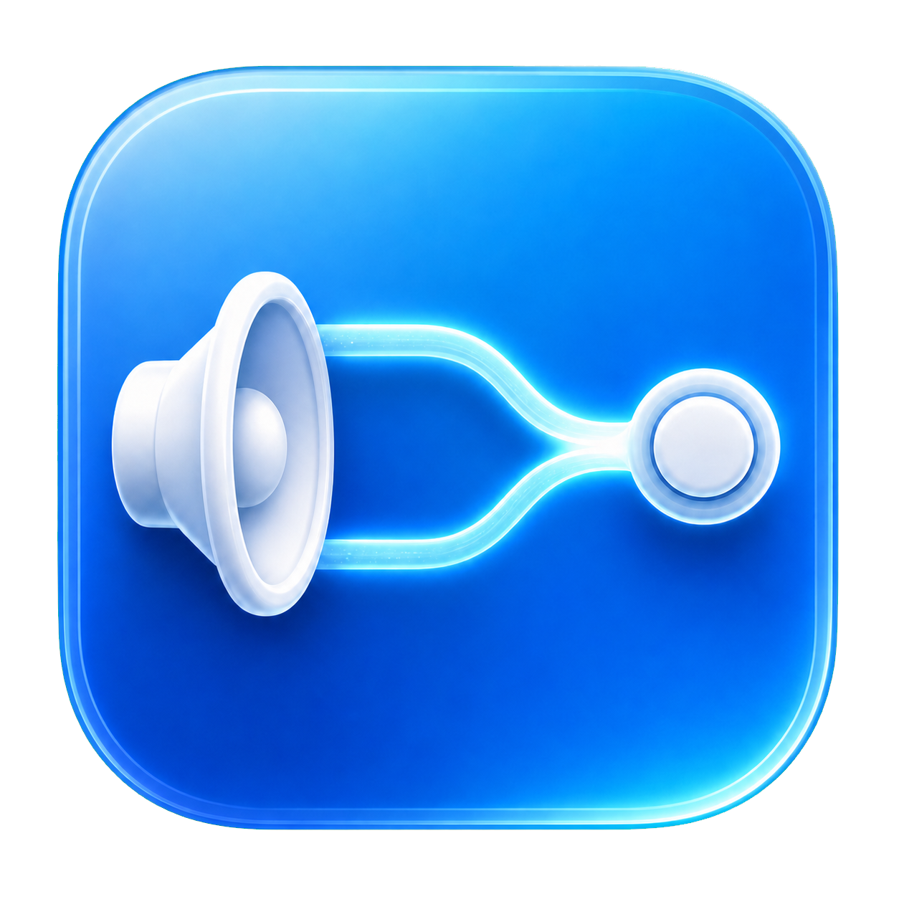
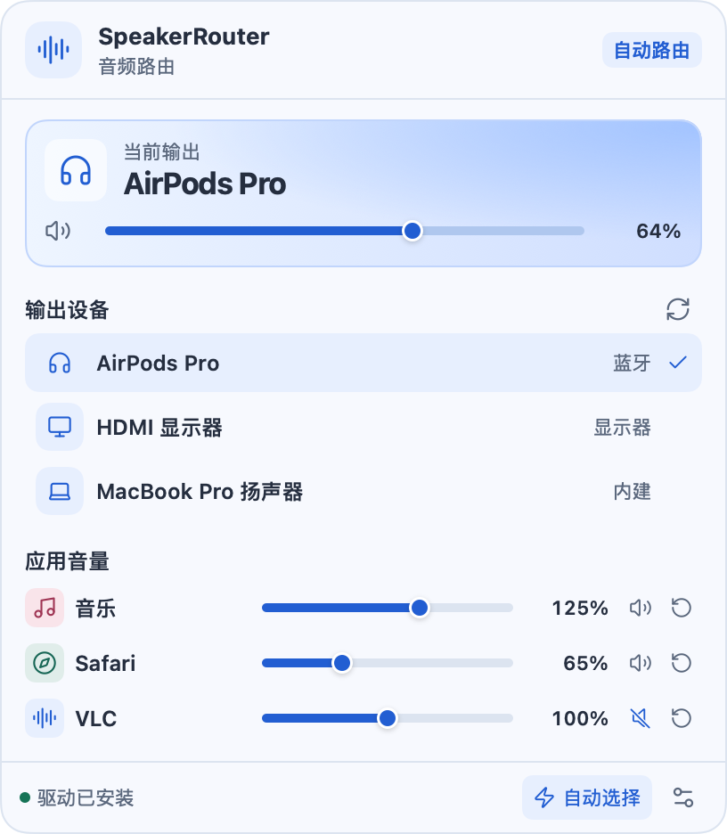
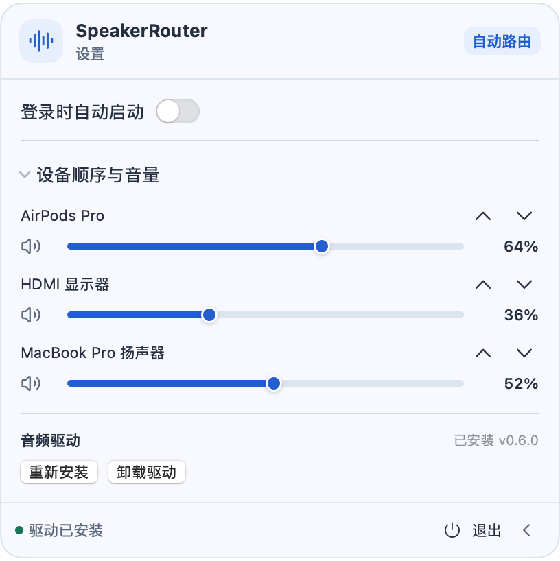

# SpeakerRouter

<p align="center">
  
</p>

SpeakerRouter 是一个 macOS 菜单栏应用。它把系统声音发送到优先级最高的
可用输出设备，支持按应用独立调节音量，也能用系统音量键控制 HDMI、
DisplayPort 等设备的输出音量。

> [!IMPORTANT]
> 当前项目适合自行构建和测试。构建产物使用 ad-hoc 签名，尚未提供 Developer
> ID 签名、notarization 或自动更新。虚拟音频驱动需要管理员授权安装。

## 界面截图

<p align="center">
  
  
</p>

截图展示了音频路由、应用音量和设备设置，使用示例设备与应用。

## 功能

- **菜单栏音频面板**集中显示当前输出、总音量、在线与离线设备，以及正在播放的
  应用。点设置图标可调整设备顺序与音量、设置登录时启动或管理音频驱动。
- **按应用调音量**支持 0–200% 独立增益、静音和恢复默认音量。可识别的应用
  会记住设置，系统音量键与静音键继续控制当前输出的总音量。
- **自动路由与手动锁定**支持内建扬声器、有线耳机、蓝牙、USB、HDMI、
  DisplayPort 和 AirPlay。自动模式使用优先级最高的在线设备，手动选中的设备
  会保持锁定直到断开或点「自动选择」。每台设备各自记忆总音量。
- **AirPods 摘戴控制与恢复**会在摘下时暂停媒体，重新戴上时只恢复
  SpeakerRouter 暂停的播放，也支持用户手动恢复单耳播放。如果 AirPods 仍保持
  蓝牙连接，但重新戴上后音频输出仍未出现，且路由顺序允许回到该设备，
  SpeakerRouter 会在收到新的佩戴事件后尝试一次重连。自动续播会等到音频输出恢复。
- **音频保护和恢复**在混音后限制峰值，校正虚拟与物理设备的时钟漂移，并向
  macOS 上报输出延迟。改进了大批次音频写入时的缓冲处理，以减少断音。
  当前耳机断开时会先发出暂停命令，再切到后备输出。App 异常退出或心跳停止时，
  守护进程会恢复最近可用的物理输出。

## 系统要求

- macOS 14 或更高版本。
- Xcode 26 或兼容 Swift 6.2 的工具链。
- CMake 3.15 或更高版本，用于构建 MediaRemote Adapter。
- Apple Silicon 或 Intel Mac。
- 安装驱动时需要管理员权限。
- AirPods 佩戴检测需要蓝牙权限，不需要麦克风权限。

## 音频路径

```text
macOS 应用与系统声音
          │
          ▼
SpeakerRouter 虚拟输出：按应用调音量 → 混音
          │  共享内存环形缓冲
          ▼
总音量与静音 → 峰值保护 → AUHAL → 选中的物理输出
```

虚拟设备保留完整的 Core Audio 对象模型，但输入流只返回静音，SpeakerRouterApp
不会打开它。因此正常路由不会请求麦克风权限，也不会触发录音指示器。更多实现
细节见 [Technical Design](Documentation/TechnicalDesign.md)。

## 构建与测试

首次克隆时需要同时获取子模块：

```sh
git clone --recurse-submodules https://github.com/liubaoyua/SpeakerRouter-macOS.git
```

已有工作区可以运行 `git submodule update --init --recursive`。

```sh
swift test
./Scripts/build-driver.sh
./Scripts/test-driver.sh
./Scripts/build-app.sh
```

输出位置：

- App：`DerivedData/Products/SpeakerRouter.app`
- 驱动：`DerivedData/ManualBuild/SpeakerRouterHAL.driver`

`build-app.sh` 会构建通用架构驱动、MediaRemote Adapter、App、崩溃守护进程和
AirPods 重连助手，并对最终 App bundle 执行 ad-hoc 签名。构建过程不会安装 App
或修改系统驱动目录。

## 安装和使用

1. 将 `DerivedData/Products/SpeakerRouter.app` 复制到 `/Applications`。
2. 打开 SpeakerRouter，点击菜单栏图标打开面板。
3. 点右下角的设置图标，在「音频驱动」里点「安装驱动」。已有旧版驱动时点「更新驱动」。
4. 通过管理员授权后，等待 Core Audio 服务恢复。
5. 展开设置中的「设备顺序与音量」设置自动路由的优先级。返回主面板后，
   点一台在线设备可手动锁定，点「自动选择」可恢复按优先级切换。

登录时启动仅会在 App 位于 `/Applications` 后注册。开发目录中的构建不会创建
持久登录项。

安装或更新驱动后，正在通过 SpeakerRouter 播放的应用会出现在主面板的
「应用音量」列表中。
使用滑块调节音量，点扬声器图标静音，点恢复图标回到 100% 并取消静音。
100% 保留原音量，150% 约为 +3.5 dB，200% 约为 +6 dB。多个应用同时放大且
混音超过输出余量时，峰值保护会暂时降低混音增益。能识别宿主的应用会按
Bundle ID 恢复设置。无法确认宿主的辅助进程各自显示，设置只在该进程的
音频连接内有效。

使用 AirPods 录音或触发快捷指令时若遇到短暂断音，请查看
[AirPods 播放中断排查](Documentation/Troubleshooting.md#airpods-playback-briefly-drops-when-recording-or-triggering-a-shortcut)。

## 卸载

先打开菜单栏面板的设置，在「音频驱动」里选择「卸载驱动」，输入管理员密码并
等待音频服务恢复。如果启用了登录时启动，请关闭该选项。最后退出并删除
`/Applications/SpeakerRouter.app`。

命令行开发环境也可以运行：

```sh
sudo ./Scripts/uninstall-driver.sh
```

驱动管理脚本只会操作 bundle identifier 为
`com.liubaoyuan.SpeakerRouterHAL` 的目标，避免误删其他 HAL 驱动。

## 数据与隐私

SpeakerRouter 不包含网络请求、遥测或崩溃上报。设备顺序、手动锁定状态和分设备
音量保存在：

```text
~/Library/Application Support/SpeakerRouter/routing-state.json
```

守护进程的心跳文件位于同一目录。可识别应用的音量和静音设置保存在本机 App
偏好中。共享音频内存使用一次性随机名称，驱动成功映射后名称立即解除链接。

AirPods 是当前物理输出时，App 会检测佩戴状态。如果音频输出消失但蓝牙仍连接，
等待恢复期间会继续监听同一副 AirPods。App 按该设备的地址过滤本机
`bluetoothd` 佩戴日志，并保留蓝牙 proximity 广播作为回退。这些内容不会保存
或上传。拒绝蓝牙权限会停用广播回退，音频路由仍可使用。

播放状态由 App 内置的 MediaRemote Adapter helper 在本机读取。它使用 macOS
自带的 `/usr/bin/perl` 加载辅助 framework，只向 SpeakerRouter 输出不含封面的
本地 JSON 状态，不发起网络请求。Adapter 失效时自动回退到虚拟音频帧活动判断。

## 项目结构

- `Sources/SpeakerRouterApp`：菜单栏 UI、驱动管理和路由生命周期。
- `Sources/SpeakerRouterCore`：设备发现、路由状态、音量和 AUHAL 转发。
- `Sources/SpeakerRouterAudioSupport`：实时安全的共享内存环形缓冲。
- `Sources/SpeakerRouterGuard`：异常退出后的物理输出恢复。
- `Sources/SpeakerRouterBluetoothRecovery`：独立运行的 AirPods 蓝牙重连助手。
- `Driver/SpeakerRouterHAL`：基于 Apple NullAudio 示例的 AudioServerPlugIn。
- `ThirdParty/mediaremote-adapter`：固定版本的 BSD MediaRemote Adapter 子模块。
- `Tests`：路由策略、持久化和共享传输测试。
- `Documentation`：需求、技术设计、状态和故障排查。

## 已知限制

- 当前固定请求 48 kHz，显式的跨设备采样率转换尚未实现。
- AirPlay、蓝牙和部分 USB 设备的热插拔行为依赖对应 Core Audio 驱动。
- 不同 AirPods 型号和蓝牙编码模式仍需要持续进行真机延迟验证。
- 播放状态和媒体控制依赖 macOS 的内部 MediaRemote framework。Adapter 失效时，
  App 会回退到用音频帧判断播放状态。
- AirPods 佩戴检测依赖蓝牙广播和 `bluetoothd` 的内部日志格式。佩戴检测已在
  AirPods 4 上验证，自动重连在不同机型和 macOS 版本上的行为仍需实测。
- 公共二进制发布前仍需 Developer ID 签名和 notarization。

遇到无声、驱动状态不一致或菜单栏未出现时，请先查看
[Troubleshooting](Documentation/Troubleshooting.md)。

## 参与贡献

提交修改前请阅读 [CONTRIBUTING.md](CONTRIBUTING.md) 和
[SECURITY.md](SECURITY.md)。路线行为和安全边界记录在
[Requirements](Documentation/Requirements.md) 中。

## 许可证

除特别说明外，项目使用 [MIT License](LICENSE)。
`Driver/SpeakerRouterHAL` 派生自 Apple 的 NullAudio 示例，并保留该目录内的
[LICENSE.txt](Driver/SpeakerRouterHAL/LICENSE.txt)。

第三方组件及其许可证见 [THIRD_PARTY_NOTICES.md](THIRD_PARTY_NOTICES.md)。
