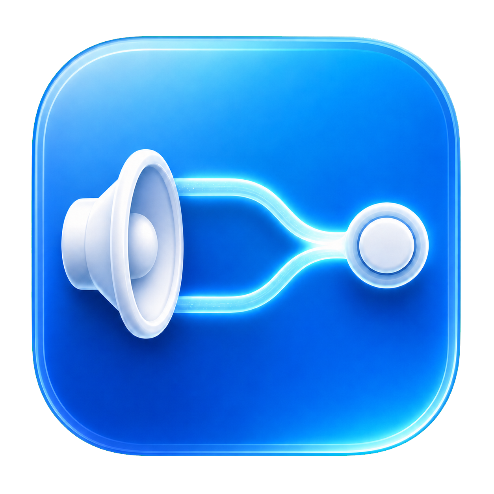

# SpeakerRouter

<p align="center">
  
</p>

SpeakerRouter 是一个 macOS 菜单栏应用。它把系统声音发送到优先级最高的
物理输出设备，并为 HDMI、DisplayPort 等不支持系统音量调节的设备提供软件
音量控制。

> [!IMPORTANT]
> 当前项目适合自行构建和测试。构建产物使用 ad-hoc 签名，尚未提供 Developer
> ID 签名、notarization 或自动更新。虚拟音频驱动需要管理员授权安装。

## 功能

- 支持内建扬声器、有线耳机、蓝牙、USB、HDMI、DisplayPort 和 AirPlay 输出。
- 为新设备提供默认分类优先级，并允许手动调整设备顺序。
- 手动选择会保持到该设备断开；断开后恢复自动选择。
- 分设备记忆音量，支持系统音量键、静音键和原生音量 HUD。
- 「应用音量」列出正在通过 SpeakerRouter 播放的应用。每个应用可独立调到
  0–200%、静音或恢复到 100%。系统音量键仍调节最终输出的总音量。
- 通过虚拟输出设备和共享内存转发系统混音，不打开麦克风输入。
- App 异常退出或心跳停止时，守护进程恢复最近可用的物理输出。
- 自动校正虚拟设备与物理设备的时钟漂移，并限制排队音频的最大延迟。
- 向 macOS 上报下游输出延迟，改善 AirPods 等无线设备的音画同步。
- 当前耳机断开时转发明确的暂停命令，再切换到后备输出。
- 当前输出为 AirPods 时，摘下会暂停正在播放的媒体；只有此次媒体确实由
  SpeakerRouter 暂停，重新戴上才会继续播放。
- App 内提供驱动安装、更新、重新安装和卸载入口。

## 系统要求

- macOS 14 或更高版本。
- Xcode 26 或兼容 Swift 6.2 的工具链。
- CMake 3.15 或更高版本，用于构建 MediaRemote Adapter。
- Apple Silicon 或 Intel Mac。
- 安装驱动时需要管理员权限。
- AirPods 佩戴检测需要蓝牙权限，不需要麦克风权限。

## 音频路径

```text
macOS 应用与系统声音
          │
          ▼
SpeakerRouter 虚拟输出：按应用调音量 → 混音
          │  共享内存环形缓冲
          ▼
总音量与静音 → 峰值保护 → AUHAL → 选中的物理输出
```

虚拟设备保留完整的 Core Audio 对象模型，但输入流只返回静音，SpeakerRouterApp
不会打开它。因此正常路由不会请求麦克风权限，也不会触发录音指示器。更多实现
细节见 [Technical Design](Documentation/TechnicalDesign.md)。

## 构建与测试

首次克隆时需要同时获取子模块：

```sh
git clone --recurse-submodules https://github.com/liubaoyua/SpeakerRouter-macOS.git
```

已有工作区可以运行 `git submodule update --init --recursive`。

```sh
swift test
./Scripts/build-driver.sh
./Scripts/test-driver.sh
./Scripts/build-app.sh
```

输出位置：

- App：`DerivedData/Products/SpeakerRouter.app`
- 驱动：`DerivedData/ManualBuild/SpeakerRouterHAL.driver`

`build-app.sh` 会构建通用架构驱动、BSD-3-Clause MediaRemote Adapter、App 和
崩溃守护进程，并对最终 App bundle 执行 ad-hoc 签名。构建过程不会安装 App 或
修改系统驱动目录。

## 安装和使用

1. 将 `DerivedData/Products/SpeakerRouter.app` 复制到 `/Applications`。
2. 打开 SpeakerRouter。
3. 在菜单栏面板的“驱动”区域选择“安装驱动”。
4. 通过管理员授权后，等待 Core Audio 服务恢复。
5. 调整设备顺序、选择自动或手动路由，并设置各设备音量。

登录时启动仅会在 App 位于 `/Applications` 后注册。开发目录中的构建不会创建
持久登录项。

使用「应用音量」需要更新到随新版 App 提供的驱动。100% 保留原音量，150% 约
为 +3.5 dB，200% 约为 +6 dB。多个应用同时播放时，若混音超过输出余量，峰值
保护会暂时降低整个混音的增益。能识别宿主的应用会按 Bundle ID 恢复设置；
无法确认宿主的辅助进程各自显示，设置只在该进程的音频连接内有效。

## 卸载

先在 App 的驱动区域选择“卸载驱动”，输入管理员密码并等待音频服务恢复，然后
退出并删除 `/Applications/SpeakerRouter.app`。如果启用了登录时启动，请在删除
App 前先关闭该选项。

命令行开发环境也可以运行：

```sh
sudo ./Scripts/uninstall-driver.sh
```

驱动管理脚本只会操作 bundle identifier 为
`com.liubaoyuan.SpeakerRouterHAL` 的目标，避免误删其他 HAL 驱动。

## 数据与隐私

SpeakerRouter 不包含网络请求、遥测或崩溃上报。设备顺序、手动锁定状态和分设备
音量保存在：

```text
~/Library/Application Support/SpeakerRouter/routing-state.json
```

守护进程的心跳文件位于同一目录。共享音频内存使用一次性随机名称，驱动成功映射
后名称立即解除链接。

AirPods 佩戴检测只在 AirPods 是当前物理输出时运行。App 按当前设备地址窄过滤
`bluetoothd` 的本机 AACP placement 日志，并保留蓝牙 proximity 广播作为回退；
这些内容不会保存或上传。拒绝蓝牙权限会停用广播回退，不影响音频路由。

播放状态由 App 内置的 MediaRemote Adapter helper 在本机读取。它使用 macOS
自带的 `/usr/bin/perl` 加载辅助 framework，只向 SpeakerRouter 输出不含封面的
本地 JSON 状态，不发起网络请求。Adapter 失效时自动回退到虚拟音频帧活动判断。

## 项目结构

- `Sources/SpeakerRouterApp`：菜单栏 UI、驱动管理和路由生命周期。
- `Sources/SpeakerRouterCore`：设备发现、路由状态、音量和 AUHAL 转发。
- `Sources/SpeakerRouterAudioSupport`：实时安全的共享内存环形缓冲。
- `Sources/SpeakerRouterGuard`：异常退出后的物理输出恢复。
- `Driver/SpeakerRouterHAL`：基于 Apple NullAudio 示例的 AudioServerPlugIn。
- `ThirdParty/mediaremote-adapter`：固定版本的 BSD MediaRemote Adapter 子模块。
- `Tests`：路由策略、持久化和共享传输测试。
- `Documentation`：需求、技术设计、状态和故障排查。

## 已知限制

- 当前固定请求 48 kHz；显式的跨设备采样率转换尚未实现。
- AirPlay、蓝牙和部分 USB 设备的热插拔行为依赖对应 Core Audio 驱动。
- 不同 AirPods 型号和蓝牙编码模式仍需要持续进行真机延迟验证。
- 播放状态和媒体控制依赖非公开的 macOS MediaRemote framework，并通过系统
  Perl helper 访问；未来系统版本仍可能使 Adapter 失效，此时只保留音频帧回退。
- AirPods placement 广播格式不是 Apple 的公共 API；已验证 AirPods 4，但其他
  型号和未来固件仍需真机验证，解析失败时会安全退化为不控制播放。
- 已连接 AirPods 的单耳 placement 补充来源依赖 `bluetoothd` 的内部日志格式；
  macOS 更新若改变该格式，仍会回退到 proximity 广播。
- 公共二进制发布前仍需 Developer ID 签名和 notarization。

遇到无声、驱动状态不一致或菜单栏未出现时，请先查看
[Troubleshooting](Documentation/Troubleshooting.md)。

## 参与贡献

提交修改前请阅读 [CONTRIBUTING.md](CONTRIBUTING.md) 和
[SECURITY.md](SECURITY.md)。路线行为和安全边界记录在
[Requirements](Documentation/Requirements.md) 中。

## 许可证

除特别说明外，项目使用 [MIT License](LICENSE)。
`Driver/SpeakerRouterHAL` 派生自 Apple 的 NullAudio 示例，并保留该目录内的
[LICENSE.txt](Driver/SpeakerRouterHAL/LICENSE.txt)。

第三方组件及其许可证见 [THIRD_PARTY_NOTICES.md](THIRD_PARTY_NOTICES.md)。
